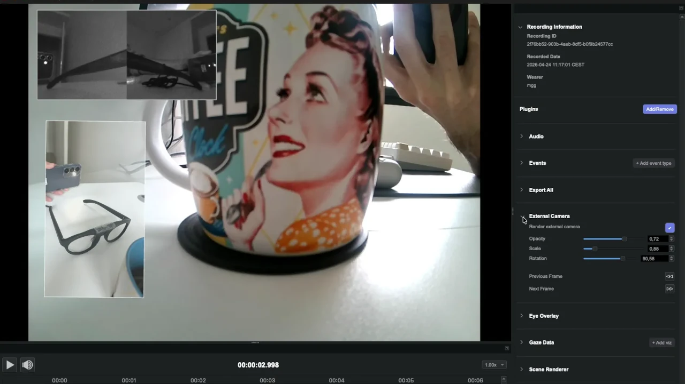
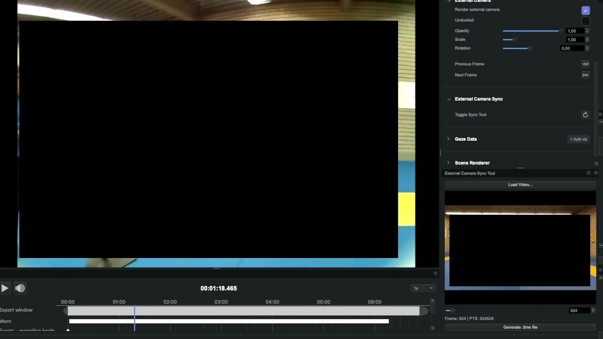
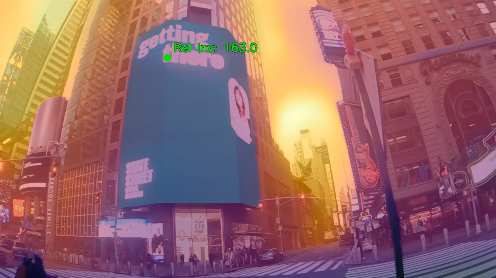
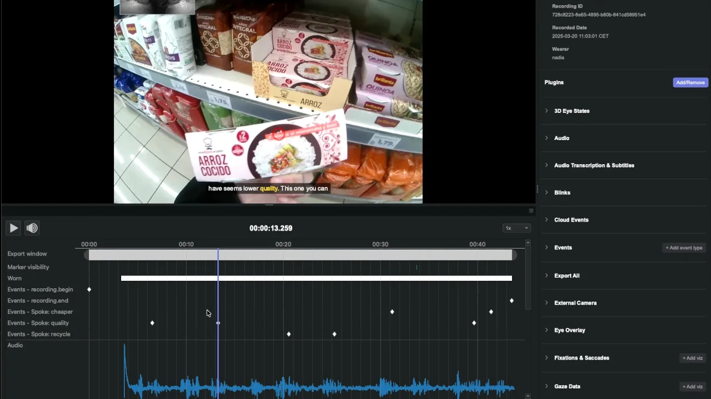
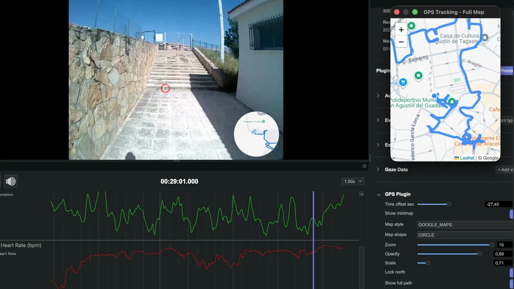
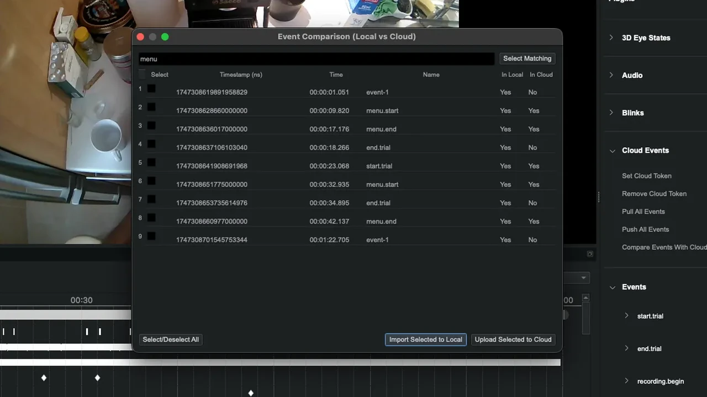

# Neon Player Plugins 

A curated list of plugins for [Neon Player](https://docs.pupil-labs.com/neon/neon-player/) by [Pupil Labs](https://pupil-labs.com/) and the community.

Neon Player allows you to extend its functionality through Python plugins. This repository serves as a central hub to discover, share, and collaborate on these plugins.

> [!TIP]
> Check out how to [install them](https://docs.pupil-labs.com/neon/neon-player/plugin-api/) or [create them](https://docs.pupil-labs.com/neon/neon-player/develop-your-own-plugin/).

- [Neon Player Repo & API](https://github.com/pupil-labs/neon-player-beta?tab=readme-ov-file)

> [!WARNING]
> Plugins in this repository may be subject to individual licenses set by their authors in the source code, documentation, or README.md table. All plugins are provided "as-is." Pupil Labs assumes no responsibility for their functionality or support.

## Contents

- [Video & External Cameras](#video--external-cameras)
  - [external_camera.py](#external_camerapy)
  - [external_camera_manual_sync.py](#external_camera_manual_syncpy)
  - [depth_estimation.py](#depth_estimationpy)
- [Audio Processing](#audio-processing)
  - [transcribe.py](#transcribepy)
- [Data Integrations & Biometrics](#data-integrations--biometrics)
  - [gps.py](#gpspy)
- [Cloud & Synchronization](#cloud--synchronization)
  - [cloud_events.py](#cloud_eventspy)

---
- [Contributing](#contributing)
- [Code of Conduct](#code-of-conduct)
- [License](#license)

## Video & External Cameras

### [external_camera.py](https://github.com/pupil-labs/npp-external-camera)

| Screenshot |                                                                            Brief description / Comments | Author | Date/Version last tested | Link (if external) | License |
|--- |--------------------------------------------------------------------------------------------------------:|--------------------------------------: |--------:	|--------------------:	|--- |
| 	| External camera plugin. Loads an external camera video and presents it in sync with Neon's scene video. | [@pupil-labs](https://github.com/pupil-labs) | 6.0.13 (24/07/26) | - | MIT |

**Detailed Description:**

Requires a `.mov` format video with `.time` file that includes timestamps for each frame. Shows the external view in a Picture-in-Picture (PiP) window that can be resized, rotated, moved around, or changed in transparency. Also adds frame scrubbing capabilities, accessible with shortcuts (`Shift + H` / `Shift + L`) and the posibility to dock it to the main window to see it side-by-side with the scene camera.

**Notes:**
A tutorial on generating `.time` files while recording will be published soon. In the meantime, use the [external_camera_manual_sync.py](https://github.com/pupil-labs/npp-external-camera-manual-sync) plugin to manually sync your external camera video and generate the file.

### [external_camera_manual_sync.py](https://github.com/pupil-labs/npp-external-camera-manual-sync)

| Screenshot | Brief description / Comments | Author | Date/Version last tested | Link (if external) | License |
|--- |-------:	|--------------------------------------: |--------:	|--------------------:    |--- |
|     | External camera manual sync plugin. Loads an external camera video (.mp4) and presents a slider to manually sync frames. | [@pupil-labs](https://github.com/pupil-labs) | 6.0.13 (24/07/26) | - | MIT |

**Detailed Description:**

Designed for external cameras like GoPros that have been recorded with out syncing. Use the slider to match the external frame with the scene camera. Once matched, press "Generate .time" to create a compatible synced format that can be seamlessly used with the `external_camera.py` plugin.

### [depth_estimation.py](https://github.com/pupil-labs/npp-depth-estimation)

| Screenshot | Brief description / Comments | Author | Date/Version last tested | Link (if external) | License |
|--- |-------:	|--------------------------------------: |--------:	|--------------------:    |--- |
|     | Depth Estimation plugin. Loads a Neon recording and estimates depth using Depth Anything V3 models, specifically the optimized implementation provided by the [Awesome Depth Anything 3](https://github.com/Aedelon/awesome-depth-anything-3) repository. | [@pupil-labs](https://github.com/pupil-labs) | 6.0.13 (11/08/26) | - | MIT |

**Detailed Description:**

Load a Neon recording, enable the plugin, and select your preferred model. The plugin generates a depth map for every scene frame and extracts the depth value at the wearer's exact gaze coordinates (X, Y). Multiple model sizes are available, allowing you to prioritize faster processing speeds or metric depth output based on your project needs. For further details see the [Alpha Lab article](https://docs.pupil-labs.com/alpha-lab/depth-estimation/).

## Audio Processing

### [transcribe.py](https://github.com/pupil-labs/npp-transcribe)

| Screenshot | Brief description / Comments | Author | Date/Version last tested | Link (if external) | License |
|--- |-------:	|--------------------------------------: |--------:	|--------------------:	|--- |
|  | Audio Transcription & Subtitles plugin. Leverages Whisper and pyannote.audio for speech recognition and speaker diarization. | [@pupil-labs](https://github.com/pupil-labs) | 6.0.13 (24/07/26) | - | MIT |

**Detailed Description:**

Similar to [Audio Event Annotations](https://docs.pupil-labs.com/alpha-lab/audio-event-annotations/) article on our Alpha Lab, this plugin creates events on word boundaries, but operates entirely locally within Neon Player. Powered by Whisper for speech recognition and pyannote.audio for speaker diarization, it transcribes audio, identifies different speakers, and generates subtitle files for video playback or further analysis.

## Data Integrations & Biometrics

### [gps.py](https://github.com/pupil-labs/gps-alpha-lab/tree/main/npp-gps)

| Screenshot |                                                                                        Brief description / Comments | Author | Date/Version last tested | Link (if external) | License |
|--- |--------------------------------------------------------------------------------------------------------------------:|--------------------------------------: |--------:	|--------------------:	|--- |
| 	|        GPS tracking and visualization plugin. Loads GPS data from Garmin/Polar devices or the Neon Companion Phone. | [@pupil-labs](https://github.com/pupil-labs) | 6.0.13 (24/07/26) | - | MIT |

**Detailed Description:**

Drop the file into your recording folder. If you used our Alpha Lab's [gps tool](https://docs.pupil-labs.com/alpha-lab/gps), no offset is needed. For third-party devices such as Garmin or Polar, a time offset control is available to align data. The plugin provides an interactive map visualization showing the traveled path, events as landmarks, and a customizable minimap. It also includes GPS kinematics graphs (speed and acceleration), along with Heart Rate (HR) and Elevation graphs when loading Garmin data.
## Cloud & Synchronization

### [cloud_events.py](https://github.com/pupil-labs/npp-cloud-events)

| Screenshot |                                                                  Brief description / Comments | Author | Date/Version last tested | Link (if external) | License |
|--- |----------------------------------------------------------------------------------------------:|--------------------------------------: |--------:	|--------------------:	|--- |
| 	| Pupil Cloud events plugin. Pull, push and compare events between Neon Player and Pupil Cloud. | [@pupil-labs](https://github.com/pupil-labs) | 6.0.13 (24/07/26) | - | MIT |

**Detailed Description:**

Synchronize and manage events between Neon Player and Pupil Cloud. This plugin allows you to push, pull, and compare event data directly within Neon Player to keep your recordings aligned across both platforms.

## Contributing

Contributions are very welcome! Please read the [contribution guidelines](CONTRIBUTING.md) before submitting a pull request.

## License

The repository structure and documentation are licensed under the [MIT License](LICENSE.md). Individual plugins may be subject to separate licenses as noted in their respective source code or table entries.
